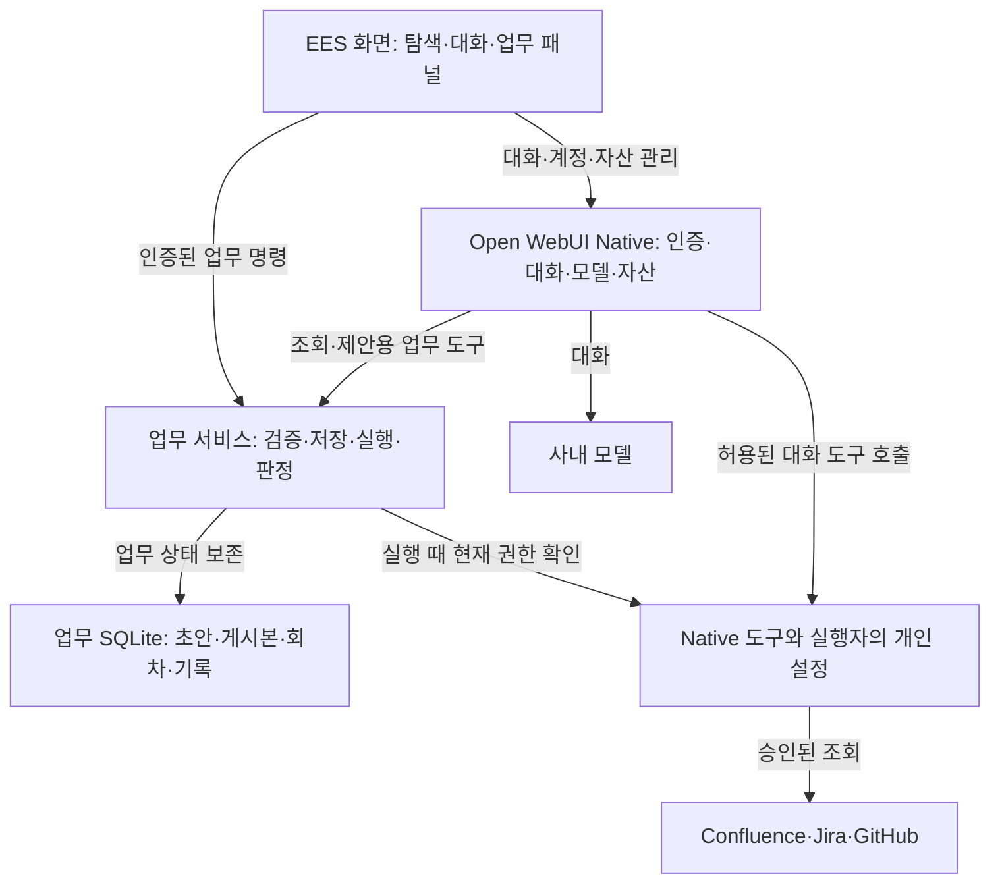

# Team Agent POC

EES 팀의 문서 조회와 업무 처리를 대화·워크플로우 화면으로 연결하는 플랫폼 PoC입니다. 왼쪽 작업 위치·탐색, 가운데 Native 대화, 오른쪽 업무/작성 패널을 사용하며 기존 Open WebUI 인증·대화·첨부·모델과 실제 도구·개인 설정을 재사용합니다. 현재 개발·미해결·사내 적용 상태는 [STATUS](docs/STATUS.md)가 원본입니다. 새 설치의 기본 콘텐츠와 프로그램·사용자 자료의 관리 경계는 아래 [원본과 배포본](#원본과-배포본)을 따릅니다.

비개발자가 EES Workflow의 Chat UI에서 사내 문서와 업무 시스템을 활용하고, 관리자가 정한 공통 정책과 업무 처리 절차를 적용받는 플랫폼 POC입니다. 범용 대화·업무용 Prompt/Skill 공유를 유지하며 Open WebUI Native를 활용합니다. **공식 Open WebUI 패키지와 우리 프로젝트 래퍼** 두 구성으로 관리하며, 이 저장소는 사내 설정·Agent Pack과 Open WebUI 수정사항·빌드/적용 절차를 관리합니다. 기존 Python·호환 의존성을 재사용하고 데이터·키는 프로그램 변경과 분리합니다. [단순 유지보수 기준](docs/03-openwebui-native-agent.md#ees-wrapper-maintenance)과 실제 구현·적용 상태는 [STATUS](docs/STATUS.md)를 따릅니다.

<a id="project-design"></a>

## 프로젝트 설계 읽기

이 README를 프로젝트 설계의 진입점으로 사용합니다. 처음 참여한 사람과 개발 AI는 [목표](#프로젝트-목표) → [전체 구조와 데이터 관계](#실행-구조와-관리-원본) → [문서 역할](#design-sources)을 읽고, 이후에는 바꾸는 기능의 원본만 따라갑니다. 코드 경로는 아래 기존 책임 표에서 찾으며 전체 API·DB 테이블·시험 목록을 여기에 복제하지 않습니다. 대상 범위는 EES 팀과 EES 관리 시스템입니다.

<a id="design-sources"></a>

현재 운영 화면은 [운영 디자인 기준·제품 적용 범위](docs/mockups/ees-work/TASK.md#work-operations-design)와 [Figma 업무·운영 전체 화면](https://www.figma.com/design/XK2wTos6sEuxSHhIj7cqg6?node-id=1705-1020)에서 시작합니다. Figma 기능 페이지에는 화면마다 최신판만 두며 판 번호는 각 페이지 헤더에 있습니다. 워크플로우 이름과 필요한 업무 구분 정보를 위에 두고, 단계 제목·실행·진행·작업 목록의 위치를 고정합니다. 현재는 실제 제품 UI 구현·검증 중이며, 사내 적용 완료는 [STATUS](docs/STATUS.md)에서 구분합니다. [25판 확정](docs/mockups/ees-work/TASK.md#work-operations-approved25-20261028)·[Figma 보완](docs/mockups/ees-work/TASK.md#operations25-figma-sync-20261028)·[20판](docs/mockups/ees-work/TASK.md#design-mock-approved20-20261027)은 이전 기록으로 보존하고, Figma의 이전 판 화면은 ‘91 · 보관’ 페이지에 있습니다.

Figma는 제품 기능을 **업무 · 운영 / 셋업 / 장애대응**으로 나누고, [업무 공통 기준](docs/mockups/ees-work/TASK.md#workflow-stage-common-standard)은 한 원본에서 연결합니다. 셋업·장애대응은 기존 참고 설계이며 아직 새 목업이 없습니다. 운영 목업의 합성 예시를 모든 업무의 실행·판정 정책으로 확대하지 않습니다.

### 설계 문서의 역할과 찾는 순서

| 필요한 답 | 관리 원본 | 읽고 고치는 범위 |
|---|---|---|
| 무엇을 만들고 각 부분은 어떻게 연결되는가 | 이 README의 목표·실행 구조·코드 책임 표 | 기능 간 책임이나 데이터·권한 경계가 바뀔 때 갱신 |
| 어떤 화면과 문구를 보여 주는가 | [Figma 기능 지도](https://www.figma.com/design/XK2wTos6sEuxSHhIj7cqg6?node-id=1288-2) → 해당 화면·명세 카드, 공통 부품은 [C1](https://www.figma.com/design/XK2wTos6sEuxSHhIj7cqg6?node-id=948-1078)·상태는 [S1](https://www.figma.com/design/XK2wTos6sEuxSHhIj7cqg6?node-id=944-1036)·움직임 기준은 [C3](https://www.figma.com/design/XK2wTos6sEuxSHhIj7cqg6?node-id=1443-137)·반응형 기준은 [Q1](https://www.figma.com/design/XK2wTos6sEuxSHhIj7cqg6?node-id=979-1252) | 배치·표시 문구·화면 이동·상태 표현. 기능 페이지는 화면마다 최신판만 두고 판 번호는 페이지 헤더에 적음. 작업실 시안과 보관 화면은 채택된 설계와 구분. 사내 확인용 디자인 목업은 [화면이 바뀌는 기능의 개발 순서](AGENTS.md#design-mock-first)를 따름 |
| 어떤 조건에서 저장·실행·완료되는가 | 대상 브랜치의 기능 명세가 있으면 그 명세, 없으면 [TASK의 해당 기능 계약](docs/mockups/ees-work/TASK.md) | 입력·권한·상태 변화·저장/반영·완료 조건. 화면 카드에는 규칙 ID와 기능별 표시 차이만 연결 |
| 어디까지 구현·검증·사내 적용됐는가 | [STATUS](docs/STATUS.md)와 거기서 연결한 PR·Checks·[평가 기록](evals/v4-ui-20260930.md) | 구현할 판 지정·코드 구현·CI 검증·사내 확인을 구분 |
| 개발 AI는 어떻게 작업하는가 | [AGENTS.md](AGENTS.md), Claude Code 진입은 [CLAUDE.md](CLAUDE.md) | 같은 지침 원본을 사용하며 기능별 상세 문서는 필요할 때 읽음 |

**공용 도구를 찾는 예:** [공용 도구 기능 명세](docs/specs/shared-tools.md)에서 시작해 [B10-1](https://www.figma.com/design/XK2wTos6sEuxSHhIj7cqg6?node-id=1369-732)·[B10-2](https://www.figma.com/design/XK2wTos6sEuxSHhIj7cqg6?node-id=1368-724)·[B10-5](https://www.figma.com/design/XK2wTos6sEuxSHhIj7cqg6?node-id=1372-741) 카드와 명세에 연결된 코드·시험 순서로 읽습니다. 이전 설계·결정 과정은 [TASK의 기능 계약](docs/mockups/ees-work/TASK.md#shared-tools-phase1-20261015)과 [PR #96](https://github.com/knadalkim-a11y/team-agent-poc/pull/96)에 보존하며, 구현·최종 검증·실제 적용 상태는 [STATUS](docs/STATUS.md)에서 구분합니다.

설계 관리의 이번 정리 범위와 Figma 후속 대상은 [작은 개선 계획](docs/mockups/ees-work/TASK.md#design-maintenance-20261016)에 모았습니다.

## 프로젝트 목표

| 목표 | 사용자에게 제공할 가치 |
|---|---|
| 1. 쉬운 Chat UI | 비개발자가 브라우저에서 자연어로 질문하고 대화 맥락을 이어갈 수 있음 |
| 2. 문서 시스템 연동 | 문서 검색·본문 조회·근거 확인을 대화 안에서 수행함 |
| 3. 관리자 공통 정책 | EES Assistant 사용 시 담당자가 관리하는 공통 원칙을 적용받음 |
| 4. 관리자 워크플로 | 업무별 처리 단계·분기·확인 절차와 필요한 도구/모델 선택을 관리자가 정해 적용함 |
| 5. 레거시 시스템 연동 | EMS/APC/FDC 등의 승인된 업무 기능을 연결해 실제 데이터를 활용함 |
| 6. 레거시의 간접 UI | 연결된 기능을 조건 입력·결과 선택·필터·비교 등 대화와 업무 화면으로 쉽게 사용함 |

공통 정책의 적용 범위는 **EES Assistant를 사용하는 대화**이며 개인 모델·개인 Assistant로 확대하지 않습니다. 워크플로는 관리자가 정하는 업무 절차라는 목표이고, Hook·동적 워크플로·오케스트레이션은 필요에 따라 선택할 구현 수단입니다. 현재 Native 호출 루프나 공유 Skill만으로 관리자가 실행 순서를 제어하는 워크플로가 완성됐다고 보지 않습니다.

목표 번호는 제품의 구성 요소이며 구현 순서는 [현재 계획](docs/STATUS.md#delivery-plan)에서 관리합니다. 레거시 연결은 작은 읽기 기능부터 시작하고 해당 업무의 간접 UI를 함께 완성합니다. 필요한 기능 화면과 시각 디자인 튜닝·첫 화면/온보딩은 구분합니다. 정책·워크플로의 배치와 확장 판단은 [Native 가이드](docs/03-openwebui-native-agent.md#managed-policy-workflow)를 따릅니다.

## 어디부터 읽나

- **개발을 이어갈 AI**: [AGENTS.md](AGENTS.md) → [현재 상태](docs/STATUS.md) → 해당 기능 파일과 테스트.
- **설치·운영할 사람**: [환경 기준](versions.md)을 읽고, 최초 설치는 [설치·기동](docs/01-openwebui-install.md), 기존 EES 환경의 업데이트는 [래퍼 운영](docs/03-openwebui-native-agent.md#ees-wrapper-maintenance)에서 시작합니다.
- **1단계 적용 이력·첫 실제 업무**: [소스 프런트엔드 적용·실패 대응](docs/03-openwebui-native-agent.md#source-frontend-apply-20261013) → [도구 등록·게시·팀원 완료](docs/07-team-quickstart.md#first-work-20261012). GitHub 토큰이 없으면 [브라우저 ZIP 적용](docs/03-openwebui-native-agent.md#source-frontend-local-zip-20261013)을 처음부터 사용합니다.
- **팀원 안내 초안**: [EES Workflow 시작 안내](docs/07-team-quickstart.md) — 팀 시연용 준비본. 실제 전달 상태는 STATUS에서 확인.
- **권한별 메뉴와 Open WebUI 왕복**: [메뉴 사용 안내](docs/03-openwebui-native-agent.md#menu-integration-20261006) · [C18 PR 1 구현 계약](docs/mockups/ees-work/TASK.md#merge-ui-20261011). EES 작성 권한과 원래 Open WebUI 권한을 구분하며 작성 중인 내용을 같은 로그인 세션에서 보존합니다.
- **시스템 담당자 작성·게시**: [v1.1 권한/보존 계약](docs/mockups/ees-work/TASK.md#system-authoring-20260924) → [가입·첫 이용·P 작성 안내](docs/07-team-quickstart.md#system-authoring-20260924) · [관리자 운영/복원/세션 경계](docs/03-openwebui-native-agent.md#system-authoring-20260924) · [SA/NU·사내 OP 평가](evals/scenarios.md#system-authoring-20260924). Native 개인 계정/그룹을 사용하고 담당 시스템의 선택 P만 저장·검사·게시합니다. 기존 업무 이용/실행/개인 자료 권한은 별도이며 A안 화면을 재사용합니다.
- **공통 Native 도구·P/T 자동 실행**: [09-25 계약·두 예제](docs/mockups/ees-work/TASK.md#shared-native-runtime-20260925) → [승인·운영·복원 경계](docs/03-openwebui-native-agent.md#shared-native-runtime-20260925) · [사용 안내](docs/07-team-quickstart.md#shared-native-runtime-20260925) · [TR-01~24 근거](evals/scenarios.md#shared-native-runtime-20260925). 기존 등록본·ACL·개인 설정으로 실행하며 채팅과 패널이 같은 영속 서비스를 사용합니다. 기존 모의 진행과 새 실행 계약을 구분하고 Windows 셋업 자동화는 후속으로 유지합니다.
- **이전 EES Work 4차 UI 구현 근거**: [v1.1 구현 범위·재사용](docs/mockups/ees-work/TASK.md#v4-ui-20260930) → [V4-01~15·실제 검증 경계](evals/v4-ui-20260930.md). 왼쪽은 공장/시스템 작업 공간과 업무 탐색, 중앙은 목록·입력/실행/결과와 상세 정보, 오른쪽은 실제 Native EES Assistant입니다. 초안·저장값·실행 snapshot과 다음 질문 참고·메시지 당시 참고·실행 대상을 구분합니다. 실제 schema·저장/승인/실행·P/T·Workspace/게시·권한 서비스를 재사용하며 기존 대화/첨부와 사용자 자산을 유지합니다. [09-28 C안](docs/mockups/ees-work/TASK.md#c-design-phase1-20260928), [09-23 A안](docs/mockups/ees-work/TASK.md#a-design-20260923), [09-22 진행/기록](docs/mockups/ees-work/TASK.md#right-panel-20260922), [업무 패널·대화 계약](docs/mockups/ees-work/TASK.md#work-panel-chat-design-20260916)은 당시 기능/검사 근거로 보존하며 당시 V4 외형 기준을 대체하지 않습니다. 새 재구성의 화면 기준은 위 Step 0-A의 현재 Figma입니다. 장기 [공동 진행과 개인 대화 분리](docs/mockups/ees-work/TASK.md#ees-work-shared-target)는 현재 사용자별 진행 건과 별개입니다.
- **준비·배포·검증 여부 확인**: [STATUS](docs/STATUS.md)의 요약과 연결된 [평가표](evals/scenarios.md)를 확인합니다. README에는 진행 상태를 복제하지 않습니다.

ChatGPT·Claude의 웹 대화에서 개발할 때는 아래 시작 지침을 프로젝트 지침 또는 작업 요청에 연결합니다. 파일이 존재한다는 이유만으로 웹 대화가 자동으로 읽었다고 가정하지 않습니다. 현재 상태는 대화 기억이 아니라 저장소에서 확인합니다.

<a id="gpt-프로젝트-최초-설정"></a>

## 개발 AI 최초 설정

1. ChatGPT 또는 Claude에서 이 개발 작업을 이어갈 프로젝트를 만들거나 기존 프로젝트를 엽니다. 예: `EES Assistant POC`.
2. 해당 프로젝트의 **지침 / Instructions**에 아래 내용을 저장합니다. 메뉴 이름은 사용하는 앱에 따라 다를 수 있습니다.
3. 그 프로젝트 안에서 개발 대화를 시작하고, GitHub 연결이 `knadalkim-a11y/team-agent-poc`에 접근 가능한지 확인합니다. PAT를 지침이나 채팅에 넣지 않습니다.

```text
이 프로젝트의 개발 원본은 GitHub knadalkim-a11y/team-agent-poc이다.
개발 작업 시작 시 요청 대상 브랜치(미지정 시 main)의 최신 커밋을 확인하고,
그 커밋의 AGENTS.md와 docs/STATUS.md를 읽어 작업 범위·검증·문서 관리·종료 규칙을 따른다.
그다음 README.md의 project-design·design-sources에서 해당 기능의 명세·Figma·코드·시험만 찾아 읽는다.
작업 전에 읽은 커밋과 설계 근거를 짧게 밝히고, 동작 변경은 같은 PR에서 해당 명세를 갱신한다.
읽지 못한 문서를 기억으로 대신하지 않고, 기존 사용자 변경을 보존한다.
저장소 접근이나 검사 실행이 불가능하면 추정해서 완료 처리하지 말고 제한을 알린다.
```

Claude Code에서는 루트 [CLAUDE.md](CLAUDE.md)가 `AGENTS.md`를 가져오도록 연결합니다. 규칙 본문은 AGENTS 한 곳에서 관리하고 README·STATUS·TASK 전체를 자동으로 가져오지 않습니다. 실제 로드 여부는 설치 환경의 `/context`로 확인하며, 조직 설정에 의한 제한은 그대로 따릅니다. [공식 설명](https://code.claude.com/docs/en/memory#share-one-file-with-other-coding-tools).

관련 열린 PR을 확인하는 세부 시작 규칙은 [AGENTS.md](AGENTS.md#1-세션-시작)에서 관리합니다. 위 지침을 이미 저장했다면 같은 문구를 다시 입력할 필요는 없습니다. 변경된 규칙이 요청 대상 브랜치에 반영되면 해당 파일을 읽을 때 적용하며, 미병합 PR을 이어갈 때는 PR 번호나 브랜치를 지정하면 됩니다.

프로젝트 지침은 그 프로젝트의 대화에 공유되지만, 연결하지 않은 저장소 접근을 새로 부여하지는 않습니다. 설정 후 새 프로젝트 대화에서 한 번만 읽은 커밋·현재 다음 작업을 확인하면 연결 여부를 점검할 수 있습니다. 사용자가 이 설정을 저장했는지는 별도 확인 전까지 완료로 기록하지 않습니다. [OpenAI 프로젝트 안내](https://learn.chatgpt.com/docs/projects)

로컬 저장소 폴더에서 실행하는 Codex의 `AGENTS.md` 자동 탐색과, GitHub 연결만 사용하는 대화는 구분합니다. 이 저장소에 파일이 있다는 사실만으로 모든 대화가 자동으로 읽는다고 가정하지 않습니다. [OpenAI AGENTS 안내](https://learn.chatgpt.com/docs/agent-configuration/agents-md)

## 저장소 지도

| 경로 | 책임 |
|---|---|
| [AGENTS.md](AGENTS.md) | 이 프로젝트를 개발하는 AI의 작업 규칙 |
| [docs/STATUS.md](docs/STATUS.md) | 현재 목표·다음 작업·미해결·Git 준비와 WebUI 적용 상태 |
| [agent-pack/](agent-pack/README.md) | 서비스 Assistant에 배포할 Prompt·정책·Skill·합성 Knowledge 원본 |
| [agent-pack/skills/confluence-read/](agent-pack/skills/confluence-read/) | 기능 단위 묶음: 지침과 실행 코드를 함께 관리 |
| [scripts/](scripts/) | 개발·운영자의 시작·점검·배포물 생성 스크립트 |
| [frontend/](frontend/) | 고정 Open WebUI 0.11.3 소스 manifest·순서가 있는 Svelte 패치; CI에서 빌드하고 사내에는 ZIP 전달 |
| [branding/ees/](branding/ees/) | EES 이름·아이콘 배포 자산; [빌드·배포 안내](docs/03-openwebui-native-agent.md#release-delivery) |
| [config/](config/) | 비밀값 없는 설정 예제 |
| [tests/](tests/) | 자동 실행하는 검증 코드 |
| [evals/](evals/) | 합격 기준·실환경 판정·날짜별 검증 증거 |
| [docs/](docs/) | 설치·연동·장애 대응 방법 |
| [docs/specs/](docs/specs/shared-tools.md) | 기능별 명세(시범): 입력 조건·상태 변화·권한·저장/반영 시점·완료 기준. 화면 배치·문구는 Figma 명세 카드 |
| [versions.md](versions.md) | 의존 버전·환경 기준 |
| [CHANGELOG.md](CHANGELOG.md) | 완료된 변경과 과거 관찰·결정 |

폴더 상세는 `rg --files`로 확인합니다. 파일 목록을 별도 문서에 계속 복사하지 않습니다. 기능에 필요한 참고자료가 생기면 해당 Skill 아래에 `references/`를 추가하되 빈 디렉터리는 미리 만들지 않습니다.

## 실행 구조와 관리 원본

### 전체 구성과 화면의 역할

아래는 같은 Open WebUI 안의 논리적 책임과 외부 연결입니다. 별도 서버를 추가하는 배포 설계가 아닙니다. 외부 연결의 실제 사용 가능 여부는 설치·권한·개인 설정과 해당 기능의 검증 상태를 따릅니다.



| 사용자 화면 | 역할 | 바꿀 때 함께 확인할 것 |
|---|---|---|
| 왼쪽 탐색 | 업무/워크스페이스 전환, 작업 위치와 대상 선택 | 선택 권한·범위, 이동 뒤 목적지, 미저장 내용 |
| 가운데 대화 | 설명·질문·근거. AI가 사용자의 요청으로 업무 기능과 상호작용(상태 읽기·칸 채우기·다음 할 일 안내) | 개인 대화·첨부 보존, 현재 참고와 메시지 당시 참고, AI가 채운 값의 반영 여부 |
| 오른쪽 업무 패널 | 구조화된 입력·결과·저장·게시·실행·확정. AI에게 초안을 맡기는 요청 기능은 두지 않고 AI가 채운 값은 구분해 표시 | 저장 전/후, 실행 권한, 회차와 게시 버전, 완료 기준 |

**AI의 역할(2026-10-26 사용자 결정):** 이 제품에는 업무 패널에서 ‘AI에게 초안을 맡기는 기능’이 따로 없습니다. AI는 두 가지로 쓰입니다. 하나는 가운데 대화에서 사용자의 요청을 받아 제품 기능과 상호작용하는 것으로, 업무 상태를 읽고 업무 패널의 입력·판정·보고 칸을 사람 확인 전 값으로 채우며 다음 할 일을 안내합니다. 다른 하나는 절차 안의 AI(LLM)로 처리하는 작업으로, 회차와 예약 실행이 다른 작업처럼 실행합니다. 어느 쪽이든 AI가 채운 값은 구분해 보이고, 사람 확인이 필요한 결과의 확정과 저장·게시는 사람이 합니다. 현재 구현된 대화 도구는 조회·입력 제안·화면 안내입니다. 수행 방법 ‘AI 초안’과 결과 형태 ‘AI 초안 검토’는 두 번째 방식의 현재 이름이며, 실행 방식은 유지하고 이름과 화면만 [화면이 바뀌는 기능의 개발 순서](AGENTS.md#design-mock-first)로 바꿉니다.

일부 자산 관리는 Native 화면을 사용합니다. EES 화면 틀과 Native 관리 화면의 전환 범위는 [메뉴 안내](docs/03-openwebui-native-agent.md#menu-integration-20261006)가 원본입니다. Figma의 목표 화면과 현재 구현의 예외를 구분합니다.

### 핵심 데이터와 변경 영향

| 대상 | 관계와 책임 | 변경 영향의 확인점 |
|---|---|---|
| 초안 | 작성자가 고치는 워크플로우 정의. 저장과 게시는 다른 행동 | 저장한 변경이 어느 게시본·회차부터 쓰이는지 |
| 게시본 | 검사와 게시로 확정된 불변 버전 | 새 게시가 이미 열린 회차의 기준을 임의로 바꾸지 않는지 |
| 회차·진행 건 | 게시 버전, 대상과 실행 범위를 가진 업무 진행 단위 | 개인 화면 선택·대화와 공동 업무 상태를 혼동하지 않는지 |
| 실행 시도·사람 판정 | 회차의 작업 실행·결과·확정 근거와 당시 기록 | 재실행 결과와 이전 근거, 현재 권한, 확정 전/후 조건 |
| 공용 도구·스킬·참고 문서 | 여러 작업이나 도우미가 참조하는 재사용 자산 | 쓰는 곳, 버전·입력/결과 호환, 저장 뒤 반영 시점·추가 조치 |
| Native 개인 자료 | 사용자 계정·대화·첨부·개인 설정·PAT | 업무 공유와 별개인 접근 권한·보존. 프로그램 갱신으로 재등록·초기화하지 않음 |

저장·게시·회차 시작·실행·결과 확정은 각각 다른 경계입니다. 도구·스킬·문서의 변경 반영 시점은 서로 같다고 가정하지 않고 해당 기능 계약을 확인합니다. 기능을 삭제·교체·병합할 때는 직접 참조하는 작업·게시본·열린 회차·기록을 확인하며, 새 규칙은 해당 기능의 원본에 한 번만 정합니다.

### 코드와 배포 원본 찾기

Native 대화와 업무 서비스는 같은 Open WebUI 프로세스에 있다. 업무 SQLite는 초안·불변 게시본·진행 건·실행 시도·사람 판정·예약·외부 요청을 구분한다. 사용자 화면 상태와 개인 대화는 공동 업무 상태와 분리한다. AI는 조회·제안·안내만 하고 저장·게시·실행·확정은 인증된 사용자 명령이 검증한다. 실제 EES 연결이 없는 요청은 명시적으로 차단하며 성공 응답을 합성하지 않는다.

- `AGENTS.md`는 개발 지침이며, `agent-pack/`의 공통 코드·실제 읽기 도구는 배포 원본이다.
- `skills`/`demo`라는 폴더 이름은 삭제 범위가 아니다. 기존 공통 서버 경로를 유지한다.
- Skill 콘텐츠·Python Tool·Native 모델 연결은 다른 자산이다. 기본 등록 콘텐츠는 비어 있으며 현재 Native 관리 기능은 유지한다.
- Git 반영·프로그램 Restore·사용자 자산 삭제/복구·실제 사내 검증은 각각 별도 결과다.

AI 개발을 위한 다음 내부 정리는 [제한적 리팩토링 설계](docs/mockups/ees-work/TASK.md#refactoring-design)의 파일별 책임·공개 연결·자료 보존·검증 기준을 따른다. 설계와 실제 구현/배포 상태는 구분한다.

업무 서버 변경은 아래 책임에서 시작합니다. 설치 후 공개 진입점은 계속 `open_webui.ees_workflow`이며, 기능 설명·수락 조건은 위 설계, 현재 구현·배포 상태는 STATUS가 관리합니다.

| 변경할 책임 | 원본 |
|---|---|
| 공개 인증 API·이전 기록 조회 | [ees_workflow.py](agent-pack/skills/ees-work-demo/scripts/ees_workflow.py) |
| 새 절차·게시 버전·진행 건·설정·판정·공유/개인 상태 | [ees_workflow_workspace.py](agent-pack/skills/ees-work-demo/scripts/ees_workflow_workspace.py) |
| 새 절차의 합성 예시·단계/작업 구조 | [workflow_procedure_examples.json](agent-pack/skills/ees-work-demo/scripts/workflow_procedure_examples.json), [작성 안내](docs/03-openwebui-native-agent.md#procedure-examples-20261006) |
| 예약·실행 시도·도구 검토·서버 확인·EES 요청 추적 | [ees_workflow_operations.py](agent-pack/skills/ees-work-demo/scripts/ees_workflow_operations.py) |
| 시스템 담당 인가·P별 초안/게시·legacy 보존·감사 | [ees_workflow_authoring.py](agent-pack/skills/ees-work-demo/scripts/ees_workflow_authoring.py) |
| 정의 읽기·참조/입력/게시 검증 | [ees_workflow_definition.py](agent-pack/skills/ees-work-demo/scripts/ees_workflow_definition.py) |
| 진행률·선행 대기·표시 상태 계산 | [ees_workflow_view.py](agent-pack/skills/ees-work-demo/scripts/ees_workflow_view.py) |
| 영속 계획·실행·호출·중단/재개·worker | [ees_workflow_execution.py](agent-pack/skills/ees-work-demo/scripts/ees_workflow_execution.py) |
| 공용 도구 확인·그룹·버전·현재 사용 가능 상태 | [ees_workflow_shared_tools.py](agent-pack/skills/ees-work-demo/scripts/ees_workflow_shared_tools.py) |
| 기존 Native 등록본 승인·현재 권한·개인 설정·호출 | [ees_workflow_native.py](agent-pack/skills/ees-work-demo/scripts/ees_workflow_native.py) |
| 입력/결과 연결·완료 검증·두 재사용 예제 | [ees_workflow_contract.py](agent-pack/skills/ees-work-demo/scripts/ees_workflow_contract.py), [ees_workflow_examples.py](https://github.com/knadalkim-a11y/team-agent-poc/blob/b41e23917273e1d2d0ead1ddadfea75b2dda1e32/agent-pack/skills/ees-work-demo/scripts/ees_workflow_examples.py) |
| 제한된 근거 정리와 Native 모델 호출 | [ees_workflow_model.py](agent-pack/skills/ees-work-demo/scripts/ees_workflow_model.py) |
| 공통 실행 정책 | [workflow_policy.json](agent-pack/skills/ees-work-demo/scripts/workflow_policy.json) |
| 참고 업무 절차·공장 예시 | [workflow_seed.json](https://github.com/knadalkim-a11y/team-agent-poc/blob/b41e23917273e1d2d0ead1ddadfea75b2dda1e32/agent-pack/skills/ees-work-demo/scripts/workflow_seed.json) |

정책과 예시의 분리는 현재 저장된 게시본·초안·진행 건을 재작성하지 않습니다. AI Tool의 [workflow_tool.py](agent-pack/skills/ees-work-demo/scripts/workflow_tool.py)와 UI는 같은 공개 서비스와 권한 판정을 사용합니다.

업무 화면의 바깥 틀·탐색·Native 대화 연결은 [고정 소스 패치](frontend/patches/0001-ees-native-hooks.patch)의 Svelte 구성에서 시작합니다. 아래 `src/lib/...` 경로는 이 저장소의 별도 디렉터리가 아니라 패치가 고정 upstream 소스에 만드는 경로입니다. 기존 세 JS 소스는 명시적으로 제공된 패널·오버레이 host 안의 업무 제어·표시·편집을 담당하며 `assemble_work_launcher`에서 배포 JS로 조립됩니다.

| 변경할 책임 | 원본 |
|---|---|
| 화면 틀·Native 경로/대화·패널 크기/초점 | [소스 패치](frontend/patches/0001-ees-native-hooks.patch)의 `src/lib/components/ees/EesShell.svelte` |
| 왼쪽 탐색·범위 드롭다운 | 같은 패치의 `EesNavigation.svelte` · `EesScopeSelect.svelte` |
| Svelte 공유 상태·현재 로그인 세션의 API 요청 | 같은 패치의 `src/lib/components/ees/state.ts` · `src/lib/apis/ees-work.ts` |
| 서버 요청·대화 연결·개인 초안·응답 순서 | [ees-work-launcher.js](branding/ees/ui/ees-work-launcher.js) |
| 공장 선택·단계별 진행·업무 패널·조건 탐색/복귀·읽기 전용 수행 상세·크기 | [ees-work-view.js](branding/ees/ui/ees-work-view.js) |
| 시스템/P별 절차 편집·미저장 초안·권한 상태·Native 셸 복원 | [ees-work-designer.js](branding/ees/ui/ees-work-designer.js) |
| 고정 소스 프런트엔드 빌드·검증 | [build_ees_frontend.py](scripts/build_ees_frontend.py) |
| 소스 조립·wheel 파일 목록·해시 | [build_ees_webui.py](scripts/build_ees_webui.py) |
| 사내 확인용 디자인 목업(제품 CSS·아이콘·글꼴로 만든 단일 HTML) | [build_design_mock.py](scripts/build_design_mock.py), 원본 `docs/mockups/ees-work/design-mock-src/`, [개발 순서](AGENTS.md#design-mock-first) |

factory는 배포 JS 내부에만 존재하고 기존 runtime UI/Tool 연결을 유지합니다. ees.11의 P별 작성 프로토콜·추가 메타데이터와 기존 전체 초안 호환은 [별도 계약](docs/mockups/ees-work/TASK.md#system-authoring-20260924)을 따릅니다. 화면 분리와 이전 프로그램 복원 검증의 실제 범위는 [R2/R3 기록](evals/scenarios.md#work-ui-refactor-20260915)을 따릅니다.

시험은 바꾸는 책임에서 시작합니다. 아래는 대표 진입점이며 전체 시험 목록과 통과 판정을 복제하지 않습니다. 실제 실행 명령·묶음은 [기존 CI](.github/workflows/ees-delivery.yml), 합격 기준·이력은 [평가표](evals/scenarios.md)에서 확인합니다.

| 변경 범위 | 먼저 확인할 기존 시험 |
|---|---|
| 공통 화면 틀·탐색·반응형 | [소스 셸 Native](tests/test_ees_source_shell_native.py), [Figma 배치 Native](tests/test_ees_work_figma_layout_native.py), [Native 복귀 선택](tests/test_ees_native_return_selection.cjs) |
| 공용 도구 조건·저장·실행 결과 | [공용 도구 Native](tests/test_ees_shared_tools_native.py), [workspace](tests/test_ees_work_workspace.py), [결과 계약](tests/test_ees_workflow_contract.py), [실행 UI](tests/test_ees_work_figma_runtime_ui.cjs) |

### 원본과 배포본

팀원이 만든 개인·공유 프롬프트·Skill·Tool은 허용된 생성·공유·수정 권한 안에서 WebUI에서 관리합니다. 공유할 때마다 담당자의 채택이나 Git 반영을 거칠 필요는 없습니다. 담당자가 팀 공통 배포 대상으로 채택한 항목만 검토한 버전을 Git에 보관하고, 이후에는 Git에서 변경을 관리해 해당 배포 절차로 반영합니다. 교차 분석 시연에 `ApplyDemo`를 쓰던 절차는 과거 기록입니다. 현재 ApplyDemo 재등록은 중지됐으며, 기존 사용자 자산의 변경은 승인된 해당 관리 절차를 따릅니다. 개발 환경에 없는 사용자 자산도 계속 보존하며, 프로그램 내부 리팩토링을 자산 ID 변경·재등록·초기화와 결합하지 않습니다.

사용자 작성물은 WebUI 실행 데이터와 함께 승인된 내부 백업으로 보존하는 운영 방침이며, 모든 작성물을 Git에 수집하지 않습니다. 이는 실제 사용자 권한 설정·공유 시험·백업이 완료됐다는 뜻이 아니며 자동 동기화도 구성하지 않았습니다. 실제 적용 상태는 [STATUS](docs/STATUS.md)에서 확인합니다.

| 대상 | 관리 원본 | WebUI 반영·보존 위치 |
|---|---|---|
| 모델 연결/허용 목록 | Native 관리자·사용자 설정 | 기반 모델 연결 유지; 전문 데모 preset을 기본 생성하지 않음 |
| 업무 공통 정책 | `agent-pack/policies/` | 검토 후 Prompt·Tool 구성에 반영; 자동 적용 아님 |
| 업무 Skill·지침 | Native Workspace Skills | 담당자가 명시적으로 관리; 사전 콘텐츠 등록 없음 |
| Git 관리 공통 실행 코드 | 해당 Skill의 `scripts/` | 지정 Workspace Tools에 해당 배포 절차로 반영 |
| 폐기 콘텐츠 관리 범위 | `agent-pack/ees-demo.json` | 빈 등록 목록과 역사 ID; ApplyDemo 중지, 별도 정리 미리보기/백업/승인 |
| EES Workflow 업무 절차·진행 건 | 업무 절차는 관리자/담당자의 업무 절차 작성기, 진행 건은 기존 사용자 업무 화면 | 기존 DATA_DIR의 `ees-work.sqlite3`; 대화·버전·현장별 실행 결과 보존. [관리·실행 경계](docs/03-openwebui-native-agent.md#ees-work-demo) |
| 검증용 합성 콘텐츠 | `tests/fixtures/` | 시험용; 제품에 자동 등록하지 않음 |
| 팀원 개인·공유 프롬프트·Skill·Tool·모델 | 승인된 실행 환경의 WebUI | 등록 ID·내용·연결·권한·개인 설정 보존; 내부 백업 대상 |
| 실제 PAT·DB·대화 | 승인된 실행 환경 | Git에 저장하지 않음 |

## 설치·검증 안내

| 할 일 | 안내 |
|---|---|
| Open WebUI 설치·시작 | [01-openwebui-install](docs/01-openwebui-install.md) |
| 기존 Windows PC로 팀 파일럿 시작 | [접속·계정·공유 범위 준비](docs/01-openwebui-install.md#local-pc-pilot) |
| 사내 Chat 모델 연결 | [02-vllm-direct-test](docs/02-vllm-direct-test.md) |
| 기본 Assistant 구성 | [03-openwebui-native-agent](docs/03-openwebui-native-agent.md) |
| 초기 Rich UI 제거·일반 답변으로 전환 | [기존 Tool·Prompt 갱신](docs/03-openwebui-native-agent.md#plain-output-update) |
| 수정·배포·원복 방식 | [배포 단위와 운영 명령](docs/03-openwebui-native-agent.md#release-delivery) |
| 사내 명령 한 번으로 프로그램·래퍼 업데이트 | [Upgrade 최초 준비·실행·실패 시 확인](docs/03-openwebui-native-agent.md#ees-wrapper-upgrade) |
| 업데이트·패치 반복 실패의 원인과 조치 확인 | [확인한 원인·보존 로그의 해석 범위](docs/03-openwebui-native-agent.md#ees-update-failure-causes), [날짜별 실패·수정·사내 결과](evals/scenarios.md#ees-update-failure-causes) |
| 승인된 Upgrade 종료 실패 복구 | [대상 식별·보관 ZIP 재사용](docs/03-openwebui-native-agent.md#ees-stop-recovery) |
| 과거 교차 분석 시연·일괄 등록 이력(현재 중지) | [ApplyDemo 당시 절차](docs/03-openwebui-native-agent.md#demo-assets-deployment). 현재 적용 지시로 사용하지 않음 |
| 기존 AI 대화에서 업무 탐색·실행·절차 관리 | [EES Workflow 적용·사용](docs/03-openwebui-native-agent.md#ees-work-demo) |
| 팀 시연용 첫 화면 적용 준비 | [소개 문구·예시 질문 초안](docs/03-openwebui-native-agent.md#first-use-entry) |
| Confluence Skill·Tool 등록 | [04-confluence-read-tool](docs/04-confluence-read-tool.md) |
| Jira 읽기·프로젝트별 현황 | [05-jira-read-tool](docs/05-jira-read-tool.md) |
| GitHub Enterprise PR 읽기 | [06-github-read-tool](docs/06-github-read-tool.md) |
| 오류 원인 분리 | [troubleshooting](docs/troubleshooting.md) |
| 합격 기준·실환경 기록 | [evals/scenarios](evals/scenarios.md) |
| Confluence 사외 시험 증거 | [evals/confluence-offline](evals/confluence-offline.md) |
| Jira 사외 시험 증거 | [evals/jira-offline](evals/jira-offline.md) |
| GitHub 사외 시험 증거 | [evals/github-offline](evals/github-offline.md) |
| 필요 시 Hermes 비교 | [03-hermes-integration](docs/03-hermes-integration.md) |

## 문서가 쌓이지 않게 유지하는 방법

개발 AI가 [AGENTS.md](AGENTS.md)의 종료 절차에 따라 관련 문서를 갱신하고, [문서 점검기](scripts/check_docs.py)를 실행합니다. AI가 검사를 실행할 수 있는 작업 환경에서는 사용자가 매번 별도로 정리를 요청하거나 사내 PC에서 실행할 필요는 없습니다. 직접 확인하려면 저장소 루트에서 실행합니다.

```powershell
python scripts/check_docs.py
# 다른 저장소 경로나 JSON 출력이 필요한 경우
python scripts/check_docs.py --root . --json
```

| 구분 | 점검 내용과 처리 |
|---|---|
| 오류 | 존재하지 않는 내부 링크·Markdown 앵커·명시적 참조 정의, 저장소 밖 경로, 읽기 실패 등을 수정 |
| 검토 후보 | README·AGENTS·SKILL 진입점에서 링크로 도달하지 못하는 루트·docs·evals 문서; 유지 또는 연결 보완 여부 검토 |
| GPT 검토 | 이번 기능 변경과 설명의 일치, 중복 원본, 더 이상 맞지 않는 절차를 관련 문서에서 확인 |
| 보존 | 과거 검증 증거와 실행용 Skill·참고자료를 참조 수나 날짜만으로 삭제하지 않음 |

- 점검기는 읽기 전용·오프라인이며 파일 수정·삭제·보고서 파일 생성을 하지 않습니다. 오류는 종료 코드 `1`, 경고만 있거나 정상이면 `0`, 잘못된 CLI 인자는 `2`입니다.
- Python 표준 라이브러리만 필요합니다. 일반 인라인·참조 링크, ATX/setext 제목·HTML id를 검사하지만 전체 CommonMark 렌더러는 아닙니다. 코드 블록·주석·외부 URL은 검사하지 않으며, 여러 줄에 걸친 링크·깊게 들여쓴 목록·복잡하거나 미완성인 문법은 수동 확인 대상입니다.
- `.git`·가상환경·`node_modules`·`data`·`runtime`·`logs` 등 코드의 `IGNORED_DIRS`에 정한 폴더와 심볼릭 링크·경로가 재지정되는 항목을 스캔하지 않습니다. `.gitignore` 규칙을 해석하는 방식은 아니며, 개별 문서는 1 MiB까지 읽습니다.
- 링크가 살아 있어도 내용이 오래됐을 수 있고, 링크가 없어도 필요한 문서일 수 있습니다. 점검 통과는 문서 전체가 최신이라는 보장이 아닙니다.
- 현재는 GPT 종료 규칙과 검사 명령까지 제공합니다. 모든 커밋을 차단하는 필수 CI나 자동 삭제·정기 실행은 구성하지 않았습니다.

<a id="branch-maintenance"></a>

## 병합 브랜치 정리

2026-09-11 점검에서 원격 34개 중 **32개는 병합된 PR의 마지막 head 그대로**이고, `main`과 미병합 커밋이 있는 `fix/upgrade-apply-failure`는 보존 대상입니다. 이름·전체 SHA·PR은 [고정 점검 목록](evals/scenarios.md#repository-maintenance-20260911)에 남깁니다. **정리 완료:** 사용자가 `branch_cleanup=ok, deleted=32`를 보고했고 원격에서도 대상 32개 삭제와 `main`·`fix/upgrade-apply-failure` 두 브랜치 보존을 확인했습니다.

아래는 2026-09-11에 실행한 절차 보존본이며 이번 정리를 위해 다시 실행할 필요는 없습니다. 당시 기존 Windows 저장소와 Git 인증으로 실행했습니다. 코드가 최신 origin/main의 점검 데이터를 읽으므로 로컬 파일·브랜치를 전환하거나 프로그램을 업데이트하지 않습니다. 고정 32개 중 이미 없는 브랜치는 건너뛰고, 원격 head 변경·main 미병합이면 삭제 전에 중단합니다. Git 서버가 보호 정책·권한·원자적 처리를 거부하면 일괄 삭제도 중단하며 강제 우회·부분 삭제로 재시도하지 않습니다. `--force-with-lease`는 점검 후 head가 바뀐 브랜치의 삭제를 막는 조건이며 커밋을 덮어쓰는 동작은 없습니다.

<details>
<summary>완료한 브랜치 정리 명령</summary>

```powershell
& {
  $ErrorActionPreference = 'Stop'
  Set-Location "$env:USERPROFILE\team-agent-poc"
  $pattern = '^(https://github\.com/|git@github\.com:|ssh://git@github\.com/)knadalkim-a11y/team-agent-poc(?:\.git)?$'
  $fetch = @(git remote get-url --all origin)
  if ($LASTEXITCODE -ne 0 -or $fetch.Count -ne 1 -or $fetch[0] -notmatch $pattern) { throw 'repository_mismatch' }
  $push = @(git remote get-url --push --all origin)
  if ($LASTEXITCODE -ne 0 -or $push.Count -ne 1 -or $push[0] -notmatch $pattern) { throw 'push_repository_mismatch' }
  git fetch --prune origin
  if ($LASTEXITCODE -ne 0) { throw 'fetch_failed' }
  $doc = @(git show origin/main:evals/scenarios.md)
  if ($LASTEXITCODE -ne 0) { throw 'audit_read_failed' }
  $rows = @($doc | Where-Object { $_ -match '^BRANCH-20260911 [a-zA-Z0-9_./-]+ [a-f0-9]{40} [0-9]+$' })
  if ($rows.Count -ne 32) { throw 'audit_count_mismatch' }
  $names = @($rows | ForEach-Object { ($_ -split ' ')[1] })
  if (@($names | Sort-Object -Unique).Count -ne 32) { throw 'duplicate_branch' }
  $lines = @(git ls-remote --heads origin)
  if ($LASTEXITCODE -ne 0) { throw 'remote_read_failed' }
  $live = @{}
  foreach ($line in $lines) { $v = $line -split '\s+'; $live[$v[1]] = $v[0] }
  $leases = @(); $targets = @()
  foreach ($row in $rows) {
    $v = $row -split ' '; $name = $v[1]; $sha = $v[2]; $ref = "refs/heads/$name"
    if ($name -in @('main','fix/upgrade-apply-failure')) { throw 'preserved_branch' }
    if (-not $live.ContainsKey($ref)) { continue }
    if ($live[$ref] -ne $sha) { throw "head_changed: $name" }
    git merge-base --is-ancestor $sha origin/main
    if ($LASTEXITCODE -ne 0) { throw "not_merged: $name" }
    $leases += ('--force-with-lease={0}:{1}' -f $ref,$sha)
    $targets += ":$ref"
  }
  if ($targets.Count -eq 0) { 'branch_cleanup=ok deleted=0'; return }
  git push --atomic @leases origin @targets
  if ($LASTEXITCODE -ne 0) { throw 'atomic_delete_failed' }
  $after = @(git ls-remote --heads origin)
  if ($LASTEXITCODE -ne 0) { throw 'delete_sent_verify_failed' }
  foreach ($line in $after) {
    if ($targets -contains (':' + ($line -split '\s+')[1])) { throw 'branch_present_recheck' }
  }
  "branch_cleanup=ok deleted=$($targets.Count)"
}
```

</details>

당시 마지막 `branch_cleanup=ok deleted=32` 한 줄로 실행 결과를 받았으며 원격 확인 결과는 위 완료 기록에 남겼습니다. push 중 통신이 끊기면 실패 출력만으로 삭제 0개라고 판단하지 않고 원격 상태부터 확인합니다. 사용자 로컬 작업 브랜치는 삭제하지 않습니다. 이번 목록에 없거나 보존 대상으로 둔 브랜치는 별도 검토 없이 추가하지 않습니다. 향후 병합 브랜치 누적을 줄이려면 저장소 Settings → General → Pull Requests의 **Automatically delete head branches**를 사용할 수 있습니다. 점검 당시 설정은 꺼져 있었고 이번 작업에서 변경하지 않았습니다.

## 범위와 안전 경계

기존 Windows PC의 Docker 없는 Open WebUI를 유지하고, 팀원이 브라우저로 접속하는 소규모 파일럿부터 진행합니다. 별도 서버 이전은 가용성·사용량 등 운영 필요가 확인될 때 검토합니다. 정확한 버전은 [환경 기준](versions.md), 접속·공유 절차는 [기존 PC 파일럿 안내](docs/01-openwebui-install.md#local-pc-pilot), 현재 상태는 [STATUS](docs/STATUS.md)에서 확인합니다. 별도 Tool Server·Router·A2A·자동 동기화는 실제 필요가 확인되고 범위가 승인된 뒤에만 추가합니다.

- 운영 DB 직접 연결, DB 자격증명, 범용 SQL·Shell·쓰기 도구는 이 POC에 제공하지 않습니다.
- 승인된 읽기 전용 API 또는 Query Broker를 연결할 때에도 도구·권한·네트워크 수준의 검증이 필요합니다.
- 실제 사내 주소·PAT·API Key·개인정보·사용자 DB·대화·키 파일은 Git에 올리지 않습니다. 설정 예제는 placeholder만 사용합니다.
- 기존 PC의 DB·키·계정·버전을 유지하며, 파일럿에 필요한 접속 범위와 일반 사용자 권한을 설정합니다. 개인 환경의 저장 검사 결과가 팀원의 접속 경로·전송 보호·사용자 격리를 대신하지는 않습니다. 추후 다른 서버로 사용자 데이터를 옮기는 작업은 별도 범위로 정합니다.
- 모델 선택기의 숨김은 UI 정리입니다. 리소스 권한과 사용자 격리는 별도로 검증합니다.
